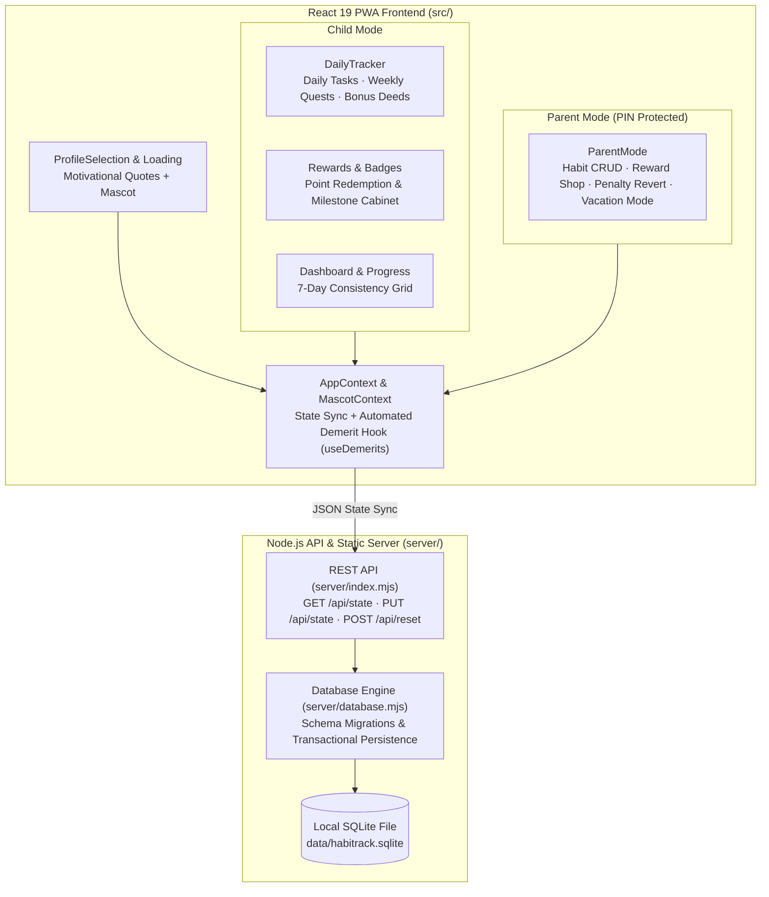

# HabitRack


**HabitRack** is a self-hosted, gamified habit and routine tracker built for kids and families. It pairs an encouraging, mascot-guided **Child Mode** (daily checklists, weekly quests, streaks, collectible badges, and a reward shop) with a PIN-protected **Parent Mode** (habit authoring, multi-child profile management, streak/demerit rules, vacation mode, and persistent SQLite storage).

---

## 🎯 Use Case & Problem Statement

Commercial habit trackers for children frequently require monthly subscriptions, store family data in third-party clouds, or lack parent-controlled accountability mechanics.

**HabitRack solves this for self-hosted families by providing:**
- **Dual-Role Experience:** A playful, distraction-free interface for children alongside a PIN-guarded parent command center (`default PIN: 0000`).
- **Daily Habits & Weekly Quests:** Supports both everyday routines (e.g., brushing teeth, reading) and flexible weekly responsibilities (e.g., cleaning the room) plus spontaneous bonus-point logging.
- **Automated Streak & Demerit Engine (`useDemerits.ts`):** Rewards consecutive completion streaks with milestone badges while enforcing configurable point deductions for missed critical habits—complete with one-click parent revert and Vacation Mode pause.
- **Zero-Dependency Embedded SQLite Persistence:** Runs a lightweight Node.js HTTP server backed by `sql.js` (`data/habitrack.sqlite`) so family data persists across devices on the home LAN without requiring an external database server.

---

## 🏗️ System Architecture



---

## 📁 Project Structure

```text
habitrack/
├── server/
│   ├── index.mjs                 # Production HTTP server (serves static build + /api/* routes)
│   ├── dev.mjs                   # Development launcher (orchestrates API server + Vite dev server)
│   └── database.mjs              # SQLite schema, migrations, default quotes, and state persistence
├── src/
│   ├── components/               # BadgeCelebration, BadgeMedallion, CheeringMascot, HabitHistoryDashboard
│   ├── context/                  # AppContext (state/API sync) & MascotContext
│   ├── hooks/
│   │   └── useDemerits.ts        # Critical-habit streak evaluation & automated penalty logic
│   ├── pages/                    # ProfileSelection, DailyTracker, Rewards, Badges, Progress, Dashboard, ParentMode
│   ├── types/                    # TypeScript domain models
│   └── utils/                    # Avatar catalog, badge rules, progress metrics, reward helpers
├── tests/
│   ├── badges.test.ts            # Unit tests for badge unlock logic
│   ├── database.test.mjs         # SQLite persistence & schema tests
│   └── e2e/habitrack.spec.ts     # End-to-end Playwright browser tests
├── Dockerfile                    # Multi-stage Node 22 Alpine container build (port 3021)
├── USER_GUIDE.md                 # Complete functional guide for parents and children
└── package.json
```

---

## 🚀 Prerequisites & Setup

### Prerequisites
- **Node.js:** `v22+` (uses native Node test runner and ES modules)
- **npm:** `v10+`
- **Docker:** *(Optional, for containerized deployment)*

### Installation

```bash
# 1. Clone the repository
git clone https://github.com/gmanojkumar2000/habitrack.git
cd habitrack

# 2. Install dependencies
npm ci
```

---

## 💻 How to Run & Test

### Run in Local Development Mode
Starts both the Node.js SQLite API backend and the Vite hot-reload frontend:
```bash
npm run dev
```

### Build & Run in Production Mode
```bash
# Compile TypeScript & bundle frontend into dist/
npm run build

# Start the production server (defaults to http://localhost:3021)
npm start
```

### Run via Docker
```bash
docker build -t habitrack .
docker run -d -p 3021:3021 -v habitrack_data:/app/data --name habitrack habitrack
```
Open `http://localhost:3021` (Default Parent Mode PIN: `0000`).

### Run Unit & End-to-End Tests
```bash
# Run Node unit & database tests
npm test

# Run Playwright E2E browser tests
npm run test:e2e

# Run ESLint static analysis
npm run lint
```
